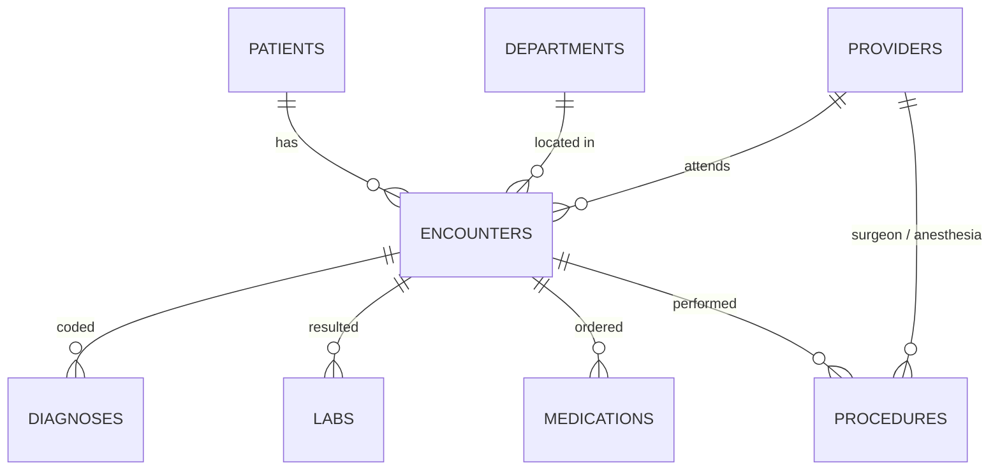

# Patient Data Reporting Database

A SQL reporting project built around a synthetic hospital dataset: 2,500 patients, 10,000+ encounters, 75,000+ lab results, and 2,000+ surgical cases. Each report starts from a realistic request a clinical department would send to an EHR/Clinical Applications analyst, then answers it with SQL.

> **All data is synthetic.** It is generated by `generate_data.py`. No real patient information is used anywhere in this project.

## Why I built this

I work Epic go-lives as an At-The-Elbow consultant, most recently in PACU and perioperative units. On the floor I see how clinicians use the system; this project is the other side of that work: how the data they enter becomes the reports that leadership, quality, and case management use to make decisions.

## The data model



| Table | What it holds |
|---|---|
| `patients` | Demographics, MRN, insurance |
| `departments` | ED, Med-Surg, Cardiac Step-Down, ICU, Main OR, PACU, clinics |
| `providers` | Attending physicians, surgeons, anesthesiologist |
| `encounters` | Every visit: class (inpatient, emergency, outpatient, surgical), admit/discharge times, disposition |
| `diagnoses` | ICD-10 codes per encounter, primary flag |
| `labs` | LOINC-coded results with reference ranges and abnormal/critical flags |
| `medications` | Orders with dose, route, start/stop |
| `procedures` | CPT-coded surgeries with OR in-room, incision, out-of-room, and PACU-out times, ASA class |

Schema: [`sql/schema.sql`](sql/schema.sql), with primary keys, foreign keys, check constraints, and indexes on the columns the reports join and filter on.

## The reports

| # | Report | Requested by | SQL techniques |
|---|---|---|---|
| 01 | [Daily census by unit](reports/01_daily_census_by_unit.sql) | Nursing leadership | Recursive CTE date series, range joins |
| 02 | [Average length of stay](reports/02_length_of_stay.sql) | Case management | Date math, `HAVING` |
| 03 | [30-day readmission rate](reports/03_readmissions_30_day.sql) | Quality | `LEAD()` window function, CTEs |
| 04 | [Abnormal labs with no follow-up](reports/04_abnormal_labs_no_followup.sql) | Primary care | `NOT EXISTS` anti-join, worklist output |
| 05 | [Surgical volume, OR and PACU times](reports/05_surgical_volume_and_or_times.sql) | Perioperative services | Time-interval math, multi-table joins |
| 06 | [PACU stay by arrival time and ASA class](reports/06_pacu_stay_by_asa.sql) | PACU manager | `CASE` bucketing, conditional aggregation |
| 07 | [Diabetics missing an A1c](reports/07_diabetic_a1c_gap.sql) | Population health | `LEFT JOIN … IS NULL`, age calculation |
| 08 | [High utilizers](reports/08_high_utilizers.sql) | Care coordination | `ROW_NUMBER()` top-1-per-group |

Full outputs are saved in [`results/`](results).

## Findings

**Med-Surg is running near capacity.** Medical-Surgical 4 West averaged 77% occupancy in September 2026 and hit all 16 staffed beds at peak. The ICU's peak census (7) exceeded its 5 staffed beds, which points to boarding.

**Heart failure drives readmissions.** Heart failure had the highest 30-day readmission rate at 22.5% (86 of 383 discharges), followed by acute kidney failure (19.6%) and COPD (17.8%). These are the diagnoses where discharge planning and follow-up calls would have the most effect.

**Late-day PACU arrivals stay 30 minutes longer.** Patients arriving in PACU at 4 PM or later averaged 120 minutes, versus 90 minutes earlier in the day. The gap holds within each acuity group (ASA 1–2: 107 vs 78 min; ASA 3+: 133 vs 102 min), so it isn't explained by sicker patients. That points to a staffing or workflow issue in the late shift, and it's the kind of finding that justifies a staffing change.

**Large care gaps in outpatient follow-up.** 1,932 abnormal clinic lab results had no follow-up visit within 30 days, and 1,048 diabetic patients had no A1c on file in the past 12 months. Both reports are formatted as worklists a clinic could act on directly.

## Run it yourself

Requires only Python 3.8+ (uses the built-in `sqlite3` module; no installs).

```bash
python generate_data.py      # create the synthetic CSVs in data/
python build_database.py     # load them into clinical.db
python run_reports.py        # run every report, save results/*.csv
python run_reports.py 03     # run a single report
```

### Write your own queries

```bash
python query.py                                  # interactive SQL prompt
python query.py "SELECT COUNT(*) FROM patients"  # one-off query
python query.py reports/03_readmissions_30_day.sql
```

At the prompt, end each query with `;`. Use `.tables`, `.schema patients`, `.save out.csv`, and `.quit`.

**Practice questions** (answers aren't included, so write them yourself):
1. How many patients does each insurance type cover?
2. Which 10 patients have the most encounters of any kind?
3. What percentage of ED visits resulted in an inpatient admission?
4. Which medication is ordered most often on the Medical ICU?
5. For each surgeon, what share of cases had an ASA class of 3 or higher?

To browse the database visually, open `clinical.db` in [DB Browser for SQLite](https://sqlitebrowser.org/) (free) and run any `.sql` file from `reports/`.

## Porting to SQL Server or PostgreSQL

The SQL is standard apart from SQLite's date functions. To move a report:

| SQLite | SQL Server | PostgreSQL |
|---|---|---|
| `julianday(b) - julianday(a)` (days) | `DATEDIFF(day, a, b)` | `EXTRACT(EPOCH FROM b - a) / 86400` |
| `datetime(x, '+30 days')` | `DATEADD(day, 30, x)` | `x + INTERVAL '30 days'` |
| `strftime('%H', x)` | `DATEPART(hour, x)` | `EXTRACT(HOUR FROM x)` |
| `a \|\| b` | `a + b` or `CONCAT(a, b)` | `a \|\| b` |

## Project layout

```
patient-reporting-db/
├── generate_data.py      # synthetic data generator (seeded, reproducible)
├── build_database.py     # creates clinical.db from schema + CSVs
├── run_reports.py        # runs reports, prints previews, saves CSVs
├── query.py              # interactive SQL console
├── sql/schema.sql        # tables, keys, constraints, indexes
├── reports/              # 8 report queries, each documented with its request
├── data/                 # generated CSVs
└── results/              # report outputs
```
